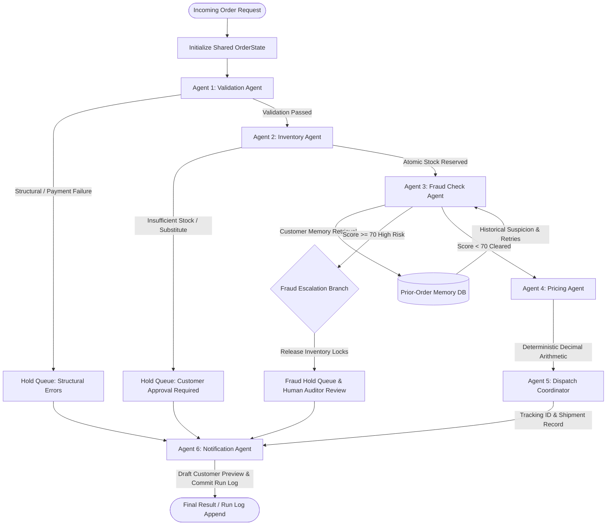

# E-Commerce Order Fulfillment Multi-Agent Architecture
### CSE476 Agentic AI and Intelligent Automation — Group 11 (Q11)

**Group Members:** Ayush Dwivedi & Tushar  
**Framework:** Microsoft Agent Framework (`agent-framework-core` v1.26.0)  
**Backend:** Python 3.12 + FastAPI + SQLAlchemy 2.0 (PostgreSQL / SQLite)  
**Frontend:** React 18 + TypeScript + Tailwind CSS  

---

## 1. Pipeline with Fraud-Escalation Route Architecture

---

## 2. Why This Architecture Fits E-Commerce Fulfillment

1. **Strict Operational Prerequisites:** E-commerce fulfillment inherently follows a dependency chain:
   - An invalid order cannot check inventory.
   - An unreserved order cannot be priced or dispatched.
   - A fraudulent order must never be dispatched or charged.
2. **Fraud Escalation Isolation:** Rather than crashing or aborting silently, high-risk orders (fraud score $\ge 70$) branch off the critical path into a dedicated human auditor queue.
3. **Atomic Stock Protection:** Reserving inventory before fraud checking guarantees that items are held if the order clears, but if the fraud check fails, the orchestrator triggers an automatic rollback compensation (`release_stock_reservation`), returning inventory to the catalog without inventory leaks.
4. **Deterministic Arithmetic:** All pricing, tax, and shipping operations use exact Python `Decimal` with `ROUND_HALF_UP`—never relying on LLM approximations for financial transactions.

---

## 3. Handled Failure Scenario: Inventory Compensation Rollback on Fraud Hold

A classic distributed failure in order management is an **orphaned inventory reservation**: an order reserves stock, but later fails fraud review, leaving stock artificially depleted.

### Step-by-Step Failure Handling:
1. Customer `CUST-003` submits an order for 3x `MON-4K-27` monitors.
2. **Validation Agent** passes the order structure.
3. **Inventory Agent** verifies stock and executes `reserve_stock_atomic()`, decrementing catalog stock by 3 and creating an `InventoryReservation` record with status `RESERVED`.
4. **Fraud Check Agent** queries `order_history` via `retrieve_customer_history()` and discovers 2 prior chargebacks, 5 failed payment retries, and a billing/shipping address mismatch.
5. The computed risk score is **100/100 (High Risk)**.
6. The **Orchestrator** intercepts the high-risk score, triggers `release_stock_reservation()`, restoring the 3 units back to `Product.stock_quantity`, and sets the reservation status to `RELEASED`.
7. The order is moved to `HELD` status with an explicit hold reason and contextual AI explanation.
8. **Notification Agent** drafts a neutral customer security verification notice.
9. **Append-Only Run Logger** records the event and rollback into `logs/execution_run_log.jsonl`.
10. The order is blocked from entering Pricing or Dispatch.

---

## 4. Prior-Order Customer Memory & Shared State

### Shared `OrderState` Schema:
The central typed Pydantic model (`backend/app/schemas/order_state.py`) passed across all agents:
- `order_id`, `customer_id`, `items`, `shipping_address`, `payment_information`
- Pipeline statuses: `validation_status`, `inventory_status`, `fraud_status`, `pricing_status`, `dispatch_status`, `notification_status`
- Quantitative state: `fraud_score`, `subtotal`, `discount_amount`, `tax_amount`, `shipping_cost`, `final_amount`
- Audit trail: `agent_execution_logs` (summary logs) and `tool_execution_logs` (granular `@tool` logs)
- Output metadata: `carrier`, `shipping_method`, `tracking_id`, `hold_reason`, `customer_notification_draft`

### Prior-Order Memory:
- Maintained in `order_history` table.
- `CustomerMemoryService.get_customer_history()` aggregates:
  - Total historical orders
  - Successful delivered orders
  - Suspicious orders and chargebacks
  - Cumulative spend and average order value
  - Payment failure retry velocity
- Isolates prior history from current order in flight, ensuring clean calculation of risk signals.

---

## 5. Database Schema (9 Relational Tables)

| Table | Purpose | Key Attributes |
|---|---|---|
| `customers` | Customer identity & status | `id`, `name`, `email`, `status` (ACTIVE/FLAGGED/BLOCKED), `address` |
| `products` | Product catalog & inventory | `sku`, `name`, `price`, `stock_quantity`, `substitute_sku` |
| `orders` | Central order state | `id`, `customer_id`, `status`, `total_amount`, `fraud_score`, `tracking_id` |
| `order_items` | Line items per order | `order_id`, `product_id`, `sku`, `quantity`, `unit_price`, `total_price` |
| `order_history` | Historical customer memory | `customer_id`, `order_id`, `status`, `amount`, `is_suspicious`, `failed_payment_attempts` |
| `agent_logs` | Audit trail of agent events | `order_id`, `agent_name`, `action`, `status`, `execution_time_ms`, `input_data`, `output_data` |
| `inventory_reservations` | Atomic stock holds | `order_id`, `product_id`, `quantity_reserved`, `status` (RESERVED/COMMITTED/RELEASED) |
| `fraud_reviews` | Risk audit and AI reasoning | `order_id`, `customer_id`, `fraud_score`, `risk_level`, `reasons`, `ai_explanation`, `decision` |
| `shipments` | Courier dispatch logistics | `order_id`, `tracking_id`, `carrier`, `shipping_method`, `status`, `estimated_delivery` |
