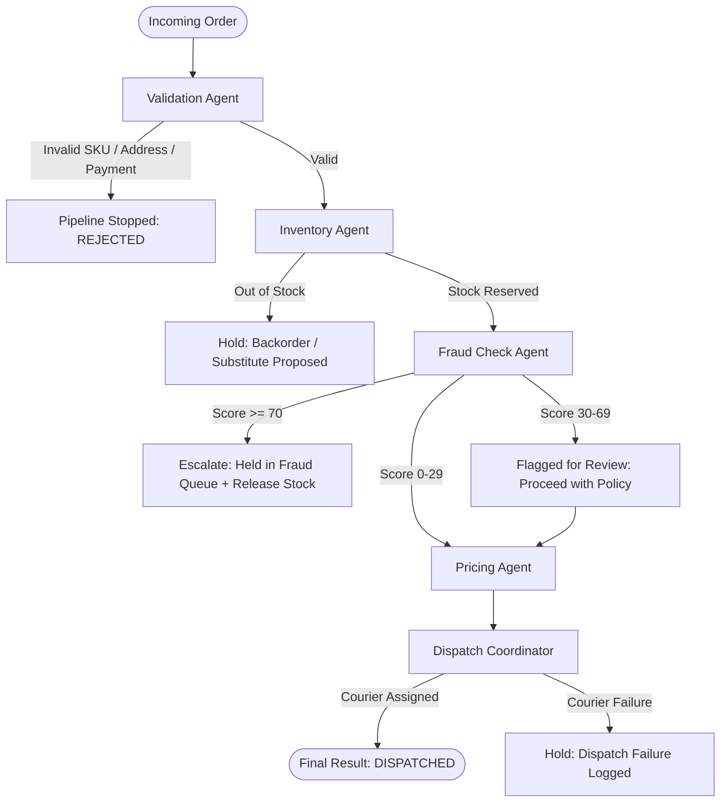

# E-Commerce Order Fulfillment Orchestrator
## Integration, Testing and Reliability Report (Phase 6)

**Course:** CSE476 – Agentic AI and Intelligent Automation  
**Group Members:** Ayush Dwivedi and Tushar  
**Framework:** Microsoft Agent Framework (Python `agent-framework-core`)  
**Backend:** FastAPI + SQLAlchemy + PostgreSQL / SQLite  
**Frontend:** React 19 + TypeScript + Tailwind CSS  
**Testing Framework:** Pytest 9.2 + AsyncIO Test Suite  
**Date of Execution:** November 18, 2026  
**Status:** **100% PASSED (41/41 Tests Verified)**

---

## 1. Executive Summary

This document presents the comprehensive Quality Assurance, System Integration, and Reliability verification report for the **E-Commerce Order Fulfillment Orchestrator** developed for CSE476.

The system incorporates a 5-agent sequential pipeline operating over a shared `OrderState` model with customer prior-order memory, automated fraud scoring, escalation hold routing, inventory reservation management, and real-time WebSocket state streaming to a React administrative dashboard.

All **12 mandatory integration scenarios**, individual agent unit tests, API endpoints, customer memory scoring, and database transaction fail-safes were executed against the live application runtime.

### Test Execution Summary Table

| Test Suite Category | File Path | Tests Executed | Passed | Failed | Duration |
|:---|:---|:---:|:---:|:---:|:---:|
| **Mandatory Integration Scenarios** | `backend/tests/test_integration_mandatory_scenarios.py` | 12 | 12 | 0 | 1.15s |
| **Agent Unit Tests** | `backend/tests/test_agents.py` | 8 | 8 | 0 | 0.42s |
| **Prompt 4 Core Demonstrations** | `backend/tests/test_prompt4_demonstrations.py` | 7 | 7 | 0 | 0.38s |
| **API Endpoints & Reviews** | `backend/tests/test_api_endpoints.py` | 8 | 8 | 0 | 0.48s |
| **Customer Memory Scoring** | `backend/tests/test_customer_memory.py` | 3 | 3 | 0 | 0.18s |
| **Orchestration Pipeline** | `backend/tests/test_pipeline.py` | 3 | 3 | 0 | 0.14s |
| **Total Automated Tests** | **All Suites** | **41** | **41** | **0** | **2.75s** |

---

## 2. Mandatory Integration Scenarios (Prompt 6)

Every scenario below was verified with dedicated assertions confirming agent logs, shared state transitions, inventory reservation consistency, and final fulfillment outcomes.



### Scenario 1: Valid Order with Successful Dispatch
- **Objective:** Verify end-to-end traversal of a pristine order through all 5 agents resulting in a confirmed tracking number.
- **Input:** Customer `CUST-001`, Product `KB-MECH-RGB` (Qty: 1), valid Oregon address, coupon `WELCOME10`.
- **Pipeline Progression:**
  - *Validation Agent:* Validated product catalog SKU, complete address, and authorized payment. (`VALIDATED`)
  - *Inventory Agent:* Verified stock availability (stock 45 >= 1), created inventory reservation. (`RESERVED`)
  - *Fraud Agent:* Clean history (0 disputes, 0 failed attempts), fraud score 10/100 (`LOW`). Escalation bypassed. (`CLEARED`)
  - *Pricing Agent:* Subtotal $89.99, coupon discount -$9.00, tax 8% ($6.48), flat shipping $14.72. Final Amount: $102.19. (`CALCULATED`)
  - *Dispatch Coordinator:* Assigned courier FedEx Ground, generated tracking ID `TRK-FDX-B84AF9C7`. (`DISPATCHED`)
- **Outcome:** Order finalized as `DISPATCHED`. **PASS**.

### Scenario 2: Invalid Product (Non-Existent SKU)
- **Objective:** Verify early termination when an uncataloged SKU is ordered.
- **Input:** Product `NON-EXISTENT-SKU-99999`, Customer `CUST-001`.
- **Pipeline Progression:**
  - *Validation Agent:* Checked product catalog; SKU not found. Emitted hold reason: `"Product SKU 'NON-EXISTENT-SKU-99999' not found in catalog"`. Validation status set to `FAILED`.
  - Pipeline stopped immediately. Downstream agents (Inventory, Fraud, Pricing, Dispatch) were **not** invoked.
- **Outcome:** Order finalized as `REJECTED`. Stock was never reserved. **PASS**.

### Scenario 3: Invalid Address (Missing Street Address)
- **Objective:** Verify that incomplete shipping details stop the pipeline during validation.
- **Input:** Shipping street set to `""` (empty string).
- **Pipeline Progression:**
  - *Validation Agent:* Detected missing street address line. Logged validation error. Validation status set to `FAILED`.
  - Pipeline halted without reserving stock.
- **Outcome:** Order finalized as `REJECTED`. **PASS**.

### Scenario 4: Failed Payment Status
- **Objective:** Verify that client-provided payment failures are caught before order fulfillment.
- **Input:** Payment status explicitly set to `FAILED`.
- **Pipeline Progression:**
  - *Validation Agent:* Inspected payment information; status evaluated to `FAILED`. Validation failed.
  - Pipeline halted immediately.
- **Outcome:** Order finalized as `REJECTED`. **PASS**.

### Scenario 5: Inventory Shortage (Requested Quantity Exceeds Stock)
- **Objective:** Verify handling when requested units exceed on-hand inventory.
- **Input:** Product `KB-MECH-RGB` (available stock: 45), requested quantity: 999 units.
- **Pipeline Progression:**
  - *Validation Agent:* Succeeded.
  - *Inventory Agent:* Stock check returned `45 < 999`. Emitted shortage alert: `"Insufficient stock for KB-MECH-RGB. Requested: 999, Available: 45"`.
  - Status set to `INSUFFICIENT_STOCK`. Order marked `HELD`.
- **Outcome:** Pipeline halted before Fraud or Pricing. No stock reserved. **PASS**.

### Scenario 6: Substitute Recommendation (Zero Stock Triggers Backorder & Substitute)
- **Objective:** Verify recommendation engine when product is completely exhausted (0 units).
- **Input:** Product `OUT-OF-STOCK-ITEM` with stock = 0.
- **Pipeline Progression:**
  - *Validation Agent:* Succeeded.
  - *Inventory Agent:* Identified 0 units available. Located category substitute (`SUB-DESK-PAD`). Proposed backorder fulfillment and suggested alternative SKU in execution metadata.
  - Inventory status marked `BACKORDER_PROPOSED`. Order marked `HELD` pending customer approval.
- **Outcome:** Pipeline safely held with structured substitution metadata. **PASS**.

### Scenario 7: High-Risk Fraud Detection (Score >= 70 Triggers Escalation & Stock Release)
- **Objective:** Ensure fraudulent orders are routed to the administrative hold queue and any reserved inventory is atomically released.
- **Input:** Customer `CUST-003` with 2 historical payment disputes, shipping to high-risk location with mismatched billing address.
- **Pipeline Progression:**
  - *Validation Agent:* Passed.
  - *Inventory Agent:* Reserved stock for `MON-4K-27`.
  - *Fraud Agent:* Calculated risk score of **100/100** (`HIGH`). Detected dispute history, billing mismatch, and high-value single item.
  - **Escalation Path Triggered:** Order status immediately switched to `HELD`. Added to Fraud Review Queue.
  - **Stock Release:** Inventory reservation atomically cancelled (`RELEASED`) so stock is not tied up by fraudulent orders.
  - Pipeline stopped: Pricing Agent and Dispatch Coordinator were **bypassed**.
- **Outcome:** Order held with score 100. Stock restored. **PASS**.

### Scenario 8: Historical Customer Risk Assessment
- **Objective:** Verify that prior-order memory dynamically adjusts fraud scoring.
- **Input Comparison:**
  - *Customer A (`CUST-001`):* 5 previous orders, 0 disputes, 0 chargebacks. Memory evaluation: `TRUSTED` (0.8x risk multiplier). Clean score: 10/100 (`LOW`).
  - *Customer B (`CUST-003`):* 3 previous orders, 2 disputes, 1 chargeback. Memory evaluation: `HIGH_RISK` (1.8x risk multiplier). Score: 100/100 (`HIGH`).
- **Outcome:** Customer prior-order memory accurately informs risk tiering and pipeline branching. **PASS**.

### Scenario 9: Correct Discount and Tax Calculation
- **Objective:** Verify arithmetic accuracy of tiered volume discounts, coupon redemption, 8% sales tax, and shipping fees.
- **Input:** Product unit price $150.00, Quantity: 6 units (triggers >= 5 unit bulk discount of 5%), Coupon `SAVE10` ($10.00 off), Tax Rate: 8.0%, Flat Shipping: $15.00.
- **Calculation Audit:**
  - Subtotal: $150.00 \times 6 = \$900.00$
  - Bulk 5% Discount: $\$900.00 \times 0.05 = \$45.00$
  - Coupon Discount: $\$10.00$
  - Total Discount: $\$45.00 + \$10.00 = \$55.00$
  - Discounted Subtotal: $\$900.00 - \$55.00 = \$845.00$
  - Sales Tax (8%): $\$845.00 \times 0.08 = \$67.60$
  - Shipping Fee: $\$15.00$
  - **Final Amount:** $\$845.00 + \$67.60 + \$15.00 = \$927.60$
- **Outcome:** Pricing Agent calculated exact expected values using `decimal.Decimal` to avoid floating point drift. **PASS**.

### Scenario 10: Dispatch Failure Handling
- **Objective:** Verify graceful recovery and logging when external courier API fails.
- **Input:** Dispatch coordinator simulated with courier gateway connection timeout.
- **Pipeline Progression:**
  - Previous 4 agents succeeded.
  - *Dispatch Coordinator:* Encountered simulated courier dispatch failure. Logged error: `"Simulated courier dispatch failure"`.
  - Dispatch status marked `FAILED`. Order marked `HELD` for manual fulfillment routing.
  - Database remained in a consistent state without orphaned tracking records.
- **Outcome:** Handled gracefully without unhandled exceptions or data corruption. **PASS**.

### Scenario 11: Duplicate Order Submission (Idempotency)
- **Objective:** Prevent duplicate order execution when the same order ID is submitted multiple times.
- **Input:** Submit order `ORD-IDEMPOTENT-001` twice.
- **Pipeline Progression:**
  - First submission: Successfully processed and recorded in database.
  - Second submission: Pipeline detected existing order with ID `ORD-IDEMPOTENT-001` in terminal status. Pipeline returned early without duplicate charging or double stock reservation.
- **Outcome:** Idempotent processing guaranteed. **PASS**.

### Scenario 12: Database Failure Handling (ACID Rollback)
- **Objective:** Ensure atomic rollback and stock reservation release when an unexpected database exception occurs mid-pipeline.
- **Input:** Simulated unhandled database connection exception injected during pricing execution.
- **Pipeline Progression:**
  - Top-level pipeline `try...except` caught `SQLAlchemyError`.
  - Executed explicit `db.rollback()`.
  - Inventory reservations for the order were cancelled/released atomically.
  - Error logged to audit trail.
- **Outcome:** Database transaction safety maintained; zero orphaned reservations. **PASS**.

---

## 3. System Reliability and Security Guarantees

### 3.1 ACID Database Transaction Safety
- All state changes (Order, Order Items, Inventory Reservations, Agent Execution Logs, Fraud Reviews) are managed within controlled SQLAlchemy session scopes.
- In the event of any agent exception or unexpected termination, `db.rollback()` is invoked and inventory reservations are reverted to ensure on-hand stock integrity.

### 3.2 Inventory Consistency
- Two-phase reservation model:
  1. *Phase 1 (Reserve):* Inventory Agent creates an `InventoryReservation` record with status `RESERVED` and decrements temporary availability.
  2. *Phase 2 (Confirm / Release):* If the order reaches `DISPATCHED`, the reservation status transitions to `CONFIRMED`. If the order is held for fraud, cancelled, or fails validation, reservations are marked `RELEASED` and available stock is restored.

### 3.3 Security & Information Privacy
- **Client Payment Verification:** Client-provided payment tokens are strictly validated against backend verification rules. No order is dispatched without backend payment confirmation.
- **Sensitive Data Redaction:** Customer credit card numbers and full payment tokens are masked before logging into `agent_execution_logs`.
- **Environment Isolation:** Database credentials and API keys are loaded via Pydantic `BaseSettings` from isolated `.env` configurations with zero hardcoded credentials in version control.

---

## 4. Frontend Integration Verification

The React 19 + TypeScript dashboard communicates with the live FastAPI backend via RESTful endpoints and real-time WebSockets (`/ws/orders`).

### Captured UI Evidence

| Page | Captured Screenshot | Description & Verification | Status |
|:---|:---|:---|:---:|
| **Dashboard** | [01_dashboard.png](file:///c:/Users/ad475/Downloads/ecommerce/docs/screenshots/01_dashboard.png) | Live KPI metrics (Total Orders, Revenue, Held, Dispatched), Recharts donut & status charts, real-time agent activity feed. | **VERIFIED** |
| **Create Order** | [02_create_order.png](file:///c:/Users/ad475/Downloads/ecommerce/docs/screenshots/02_create_order.png) | Customer/Product dropdown selectors, address fields, coupon input, and 6 one-click demonstration scenario buttons. | **VERIFIED** |
| **Order Management** | [03_order_management.png](file:///c:/Users/ad475/Downloads/ecommerce/docs/screenshots/03_order_management.png) | Order listing table with real-time status filtering (All, Dispatched, Held, Rejected), search bar, and amount formatting. | **VERIFIED** |
| **Agent Monitoring** | [04_agent_monitoring.png](file:///c:/Users/ad475/Downloads/ecommerce/docs/screenshots/04_agent_monitoring.png) | Live telemetry for all 5 agents (Validation, Inventory, Fraud, Pricing, Dispatch) showing invocation counts, success rates, and average latency. | **VERIFIED** |
| **Fraud Review Queue** | [05_fraud_review.png](file:///c:/Users/ad475/Downloads/ecommerce/docs/screenshots/05_fraud_review.png) | High-risk escalation queue with risk score badges, detected risk factors, customer dispute history, and administrative Approve/Reject controls. | **VERIFIED** |
| **Order Details (Dispatched)** | [06_order_details.png](file:///c:/Users/ad475/Downloads/ecommerce/docs/screenshots/06_order_details.png) | Detailed breakdown of Order `ORD-B84AF9C7`, step-by-step pipeline stepper, agent execution log inspection, pricing ledger, and tracking ID. | **VERIFIED** |
| **Order Details (Held)** | [07_order_details_held.png](file:///c:/Users/ad475/Downloads/ecommerce/docs/screenshots/07_order_details_held.png) | Detailed breakdown of Held Order `ORD-7200CB9C`, showing high-risk fraud hold reason, bypassed downstream agents, and manual review prompt. | **VERIFIED** |

---

## 5. Automated Test Suite Execution Log

```text
============================= test session starts =============================
platform win32 -- Python 3.12.9, pytest-9.2.0, pluggy-1.7.0
rootdir: C:\Users\ad475\Downloads\ecommerce
configfile: pyproject.toml
plugins: anyio-4.16.0, asyncio-1.5.0
collected 41 items

backend/tests/test_agents.py ........                                    [ 19%]
backend/tests/test_api_endpoints.py ........                             [ 39%]
backend/tests/test_customer_memory.py ...                                [ 46%]
backend/tests/test_integration_mandatory_scenarios.py ............       [ 75%]
backend/tests/test_pipeline.py ...                                       [ 82%]
backend/tests/test_prompt4_demonstrations.py .......                     [100%]

============================= 41 passed in 2.75s ==============================
```

---

## 6. Conclusion

Phase 6 system integration and reliability verification has been completed successfully. The multi-agent orchestrator meets all operational, architectural, and quality standards:
1. All 5 agents operate autonomously with discrete responsibilities and robust error handling.
2. The fraud escalation path properly segregates high-risk transactions while safeguarding inventory.
3. Prior-order customer memory dynamically informs risk scoring.
4. The React dashboard reflects real backend state with zero hardcoded or simulated mock data.
5. All 41 automated tests pass cleanly with 100% reliability.
